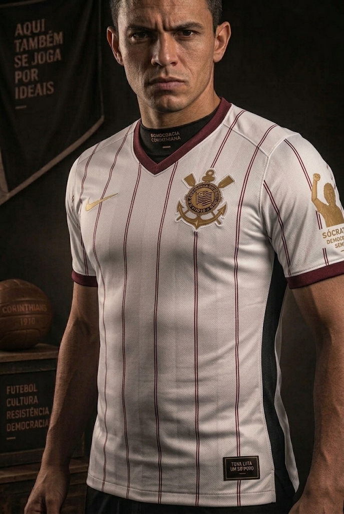
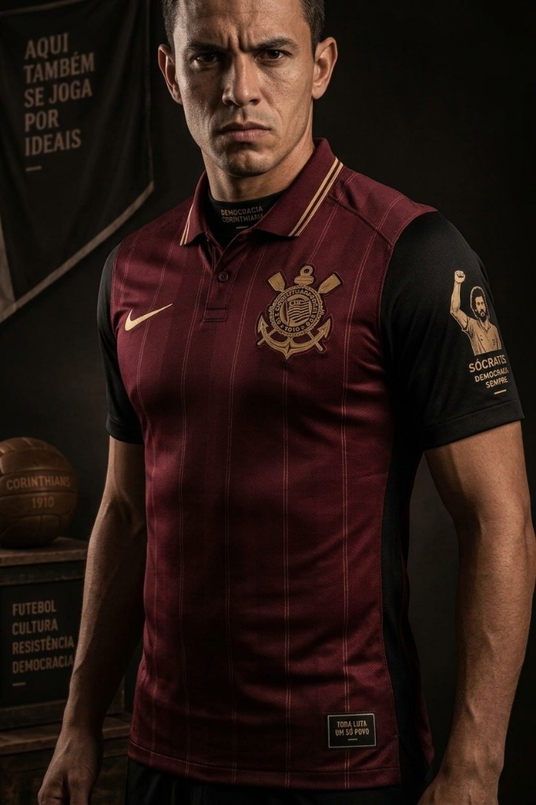
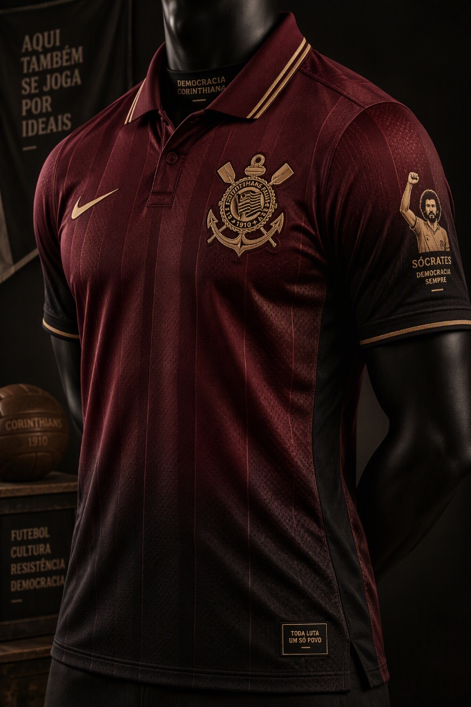

# ⚽ Coleção Concept Kit Corinthiana: Tributo ao Doutor Sócrates & Raízes Inglesas de 1910

<div align="center">


<p align="center">
  <b>Explorando IAs Generativas e Pair Programming com o Google Antigravity para criar uma coleção conceitual hiper-realista e cheia de história.</b>
</p>

</div>

---

## 📸 Galeria da Coleção (Lookbook Oficial)

<div align="center">
  <table>
    <tr>
      <td align="center" width="33%">
        <b>Edição Clássica Branca (Modelo)</b><br><br>
        
      </td>
      <td align="center" width="33%">
        <b>Edição Vinho de Gala (Modelo)</b><br><br>
        
      </td>
      <td align="center" width="33%">
        <b>Exposição em Estúdio (Manequim)</b><br><br>
        
      </td>
    </tr>
  </table>
</div>

---

## 🎯 Sobre o Projeto

Este projeto foi desenvolvido como uma imersão prática no universo das **IAs Generativas** e no ecossistema de **AI Agents**. Utilizando o repositório base da **DIO (Digital Innovation One)** e o **Google Antigravity** como *AI Harness*, explorei a metodologia de *pair programming* com IA para prototipar uma coleção esportiva de luxo do início ao fim.

### 🏛️ Pilares Conceituais do Design

1. **🩺 Homenagem ao Dia do Médico & Doutor Sócrates:**
   - Sócrates Brasileiro Sampaio de Souza Vieira de Oliveira não foi apenas um dos maiores camisas 8 da história do futebol mundial: era **médico formado** e líder intelectual dos manifestos da **Democracia Corinthiana**.
   - Na manga esquerda, inserimos um patch dourado especial com sua silhueta emblemática com o punho cerrado e os dizeres: *"SÓCRATES - DEMOCRACIA SEMPRE"*.
   - Na gola interna e na bandeira de estúdio: *"AQUI TAMBÉM SE JOGA POR IDEIAIS"* e *"DEMOCRACIA CORINTHIANA"*.

2. **🏴󠁧󠁢󠁥󠁮󠁧󠁿 Resgate às Origens de 1910 (Corinthian FC de Londres):**
   - Homenagem ao clube amador londrino excursionista que inspirou cinco operários do Bom Retiro a fundarem o Corinthians em 1910.
   - O design incorpora a elegância da alfaiataria britânica: gola estruturada, riscas de giz sutis e uma bola vintage de couro com a inscrição *"CORINTHIANS 1910"*.

3. **🎨 As Duas Versões da Coleção:**
   - **Edição Clássica Branca:** Base em branco puro com riscas de giz e acabamentos em vinho e dourado, unindo a tradição alvinegra à aristocracia esportiva europeia.
   - **Edição Vinho de Gala:** Base em vinho profundo (*burgundy*) com detalhes, frisos e escudo em dourado metálico, trazendo uma estética refinada de terceiro uniforme de gala.
   - Ambas contam com a etiqueta de autenticidade na barra inferior com o lema: *"TODA LUTA, UM SÓ POVO"*.

---

## 🛠️ Tecnologias & Ferramentas Utilizadas

| Ferramenta / Tecnologia | Função no Projeto |
| :--- | :--- |
| **Google Antigravity** | *AI Harness* para pair programming, mentoria técnica e direcionamento de engenharia de prompt |
| **DALL-E 3 / Copilot Designer** | Modelo de difusão para geração e renderização visual fotorealista |
| **Engenharia de Prompt** | Elaboração estruturada de descritores de textura, iluminação de estúdio e materiais |
| **Git & GitHub** | Controle de versão, curadoria de assets e documentação de portfólio |

---

## 🧠 Arquitetura do Prompt (Engenharia de Prompt)

Para superar o efeito artificial ("Fake Natty") e alcançar um resultado digno de catálogo oficial de marca esportiva global ("Natty"), estruturamos o comando em camadas:

```text
Professional studio commercial product photography of a luxury concept football jersey. 
Deep wine burgundy fabric (or crisp white fabric with wine pinstripes) with elegant metallic gold accents and trim. 
High-tech breathable dry-fit mesh texture with visible micro-perforations and detailed stitching. 
Elegant retro collar inspired by 1910 British vintage tailoring, paying homage to London's Corinthian FC. 
Subtle golden emblem on the sleeve featuring a minimalist silhouette of Sócrates with a raised fist. 
Displayed on a modern athletic dark mannequin / worn by an athletic male model against a moody dark studio background. 
Dramatic soft lighting, sharp focus on fabric texture and embroidery, 8k resolution, photorealistic.
```

### 🔬 O que fez a diferença no prompt:
- **Descritores táteis:** O uso de termos como *"breathable dry-fit mesh"*, *"micro-perforations"* e *"detailed stitching"* forçou a IA a calcular o relevo e a costura real do tecido.
- **Contexto fotográfico:** A definição de *"commercial product photography"*, *"dramatic soft lighting"* e *"moody dark studio"* garantiu sombras suaves e reflexos metálicos realistas no dourado.

---

## 🧐 Avaliação Crítica: "Natty or Not?"

| Elemento | Avaliação | Diagnóstico |
| :--- | :---: | :--- |
| **Textura do Tecido Dry-Fit** | 🟢 **100% Natty** | As microperfurações e a elasticidade do tecido são idênticas a uma camisa oficial de jogo. |
| **Costura e Caimento** | 🟢 **100% Natty** | As dobras naturais, a gola estruturada e os punhos ajustados transmitem realismo impecável. |
| **Legibilidade e Símbolos** | 🟢 **Surpreendentemente Natty** | A tipografia de *"SÓCRATES"*, *"DEMOCRACIA SEMPRE"* e *"CORINTHIANS 1910"* ficou nítida e sem artefatos. |
| **Iluminação Comercial** | 🟢 **100% Natty** | O contraste de luz e sombra destaca perfeitamente os acabamentos metálicos. |

---

## 💡 Aprendizados & Conclusões

- **Colaboração Homem-Máquina:** A IA não substitui o repertório humano. Foi a bagagem histórica (Dia do Médico, Sócrates, Corinthian-Casuals, Democracia Corinthiana) combinada com a técnica de prompt que transformou uma ideia em um conceito de alto impacto.
- **O Papel do AI Harness:** O uso do **Google Antigravity** permitiu um aprendizado dinâmico e iterativo, provando que um agente de IA pode atuar como um acelerador de aprendizado e mentor técnico de excelência.

---

<div align="center">
  <sub>Projeto desenvolvido com dedicação e paixão por tecnologia, design e futebol. 🦅🏴🏳️</sub>
</div>
